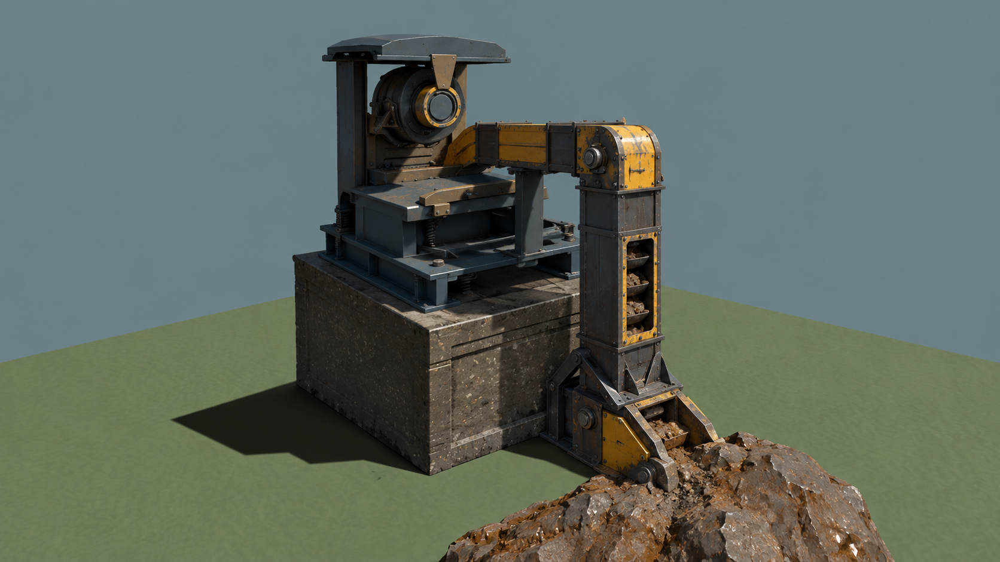
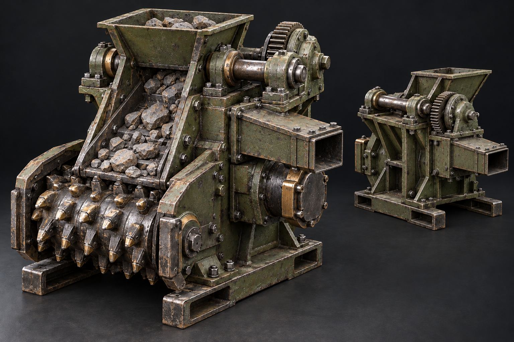

# Collector seam-facing assembly brief

This is a design brief for the **presentation** of the existing collector, not a
new mining or material rule. It follows the rejected small-chute trials in
`factory-yau.6.45.23.82`. The source and ordinary native view were read on
2026-10-22. The collector now keeps its frame and high cutter pointed toward
the fixed source while a small outlet cassette follows the confirmed quarter
turn. That corrects direction, but it does not establish a cutter-to-rock path.

## Why the current assembly is hard to read

The [ordinary confirmed worksite](../../experiments/engine-environment/godot/opening/assets/README.md)
shows an irregular mineral rock immediately behind a compact hood and stock
table. From the construction camera, the drum reads as a round detail on the
hood. The player cannot readily trace a physical route from exposed seam to
tool, then to a material outlet. The previous small rails and sloped channel
read as added decoration or covered the bed. Their preserved images and patches
are linked from `factory-yau.6.45.23.82`.

For comparison, Komatsu's [12HM continuous miner brochure](https://www.komatsu.com/content/dam/komatsu/sales-and-marketing-documents/brochures/room-pillar/12hm/en-12hmscm01-12hm-continuous-miner.pdf)
separates cutting, gathering and conveying as visible subsystems. That is an
industrial form reference, not a compatible machine model or a proposed power,
traction or production mechanic. Factory's stationary, one-cell collector must
use its own original proportions and the admitted material state.

## Current coordinate and authority map

The numbers below describe the current native adapter and Godot art. They are
not permanent gameplay dimensions.

| Fact | Current source and implication |
| --- | --- |
| Cell and ground | [Site geometry](../../experiments/engine-environment/godot/opening/site_geometry.gd) uses a 1.65 m cell and places the machine anchor at the cell centre and confirmed level. The existing plinth and pick box belong to the machine assembly. |
| Mineral site | [Mineral-site policy](../../native/mineral-site/include/factory/mineral_site.hpp) admits two opening cells, `(0, 0)` and `(0, 1)`. [Host admission](../../native/factory-godot-world/src/host.cpp) checks the chosen centre against that site and the terrain depth, including a bounded elevated-foundation reach. This is the extraction permission; no visible cutter triangle supplies it. |
| Exposed rock | [The one site-surface descriptor](../../experiments/engine-environment/godot/opening/site_surface.gd) places the fitted outcrop at world `x = -1.05`, `z = 0.05`, with its centre height derived from real terrain. The prepared local box is about 0.572 × 0.753 × 2.288 m; the [outcrop source study](mineral-outcrop-source.md) records the larger unmodified donor. The visible and physical hull share this rigid descriptor. It is one geological cue spanning the two-cell seam, with one finite reserve. |
| Existing tool | [Collector art](../../experiments/engine-environment/godot/opening/opening.gd) puts the drum centre at local `(-0.22, 1.10, -0.19)` with a 0.24 m radius and its stock bed at `(0, 0.51, 0)`. These nominal centres do not alone prove tool-to-rock surface contact; the actual transformed hulls and all cutter poses need measurement. |
| Material outlet | [World material routing](../../native/factory-world/src/world.cpp) selects the collector's single horizontal output from the confirmed quarter-turn rotation. At rotation zero it faces `+X`; the other rotations turn that vector. An adjacent belt receives material only when its endpoint faces this output and its slot is free. The small output cassette follows the native port while the source-facing frame stays fixed; its terminal remains exposed without an accepted belt. |
| Custody and motion | Native World owns extraction, finite stock, cached commands, power and material transfer. The view may depict only confirmed source quantity and machine/cutter state. A decorative chute must not invent a travelling billet, extra reserve, working connection or cutting contact. |

The fitted rock remains outside both machine construction envelopes and reaches
near each permitted seam cell. The output can now turn without turning the
cutter away from the rock, but the cutter is still high above the seam.
Read-only rays through the actual source triangles at a proposed low cutter
height found roughly 15–21 cm between the rock and the west face of the present
pick box. The earlier 4 cm gap came from the hull's overall AABB extreme and
cannot justify contact art. A low intake that reaches the real surface needs
an explicitly occupied envelope checked by native placement and ActorWorld;
the view alone cannot create that space.

### Raised collector observed in the ordinary opening

The retained native first-shift consumer in `factory-yau.6.45.24.20` adds a
different, already admitted arrangement to this art brief. Its collector is
at seam cell `(0, 1)`, level 4, on a confirmed level-4 foundation, with a
rotation-zero outlet. The reported material state and image show four collected
plates, while the foundation and machine conceal the fitted mineral ridge from
the ordinary camera. This is a working extraction case with an unreadable
source connection, not evidence that the collector failed to produce.

The current 1.65-metre cell and four height steps per cell put that collector's
base at 1.65 metres. The same site descriptor places the single rigid outcrop
near ground at world `x = -1.05`, `z = 0.05`. The foundation occupies a separate
confirmed volume beneath the raised machine. The ground-level cutter form
studied above cannot simply be translated to this base and still depict contact
with the exposed rock. A decorative shaft through the foundation would also
claim unverified clearance and actor obstruction. The Host currently admits
bounded extraction depth; that permission does not provide a rendered shaft,
cutout or collision body.

Treat direct ground contact and elevated extraction as distinct presentation
fits of the same finite source and collector identity. A raised variant needs
a measured path from the source surface to the confirmed machine intake, plus
a foundation opening or exterior support that agrees with the native physical
geometry. If that cannot be represented within the existing collision and
construction contract, change that contract deliberately rather than hiding
the mismatch with a cosmetic conduit. Compare both seam cells, relevant outlet
rotations and the retained level-4 view before accepting either art variant.
The ordinary screenshot establishes this specific visual gap; it does not
establish a new mining mechanism or human approval of a proposed fix.

### Raised intake form study

This AI-generated edit of the retained failed scaffold view is a **form
reference**, not game geometry, a sourced model, a tested mechanism or a new
material rule. The edit request kept the existing outcrop, foundation and
elevated collector while replacing the empty exterior frame with a rock-facing
pickup, a guarded vertical carrier and a head discharge entering the upper
bed. It suggests a readable sequence at a glance; none of its depicted joints,
dimensions, bucket contents or clearances have been verified against the
actual mesh or native bodies.

Real equipment makes the missing joints clear. [BEUMER's bucket-elevator
description](https://www.beumergroup.com/knowledge/mining/new-glossary/)
distinguishes a lower pickup, vertical buckets and a head discharge;
[Metso's apron-feeder explanation](https://www.metso.com/insights/blog/mining-and-metals/feeding-the-facts-part-1-apron-feeder-basics/)
describes controlled extraction into another machine. These are engineering
form references, not selected game assets. BEUMER's [heavy-duty elevator
example](https://www.beumergroup.com/products-systems/conveyors-technology/bucket-elevators/heavdy-duty-belt-bucket-elevators/)
is described for pieces up to 120 mm, while the present visual billet is about
260 × 340 mm. A modeled carrier must fit the material it actually depicts,
or depict smaller pre-billet fragments without inventing separate stock.

The next candidate must measure its lower pickup against the one finite rock,
route a real occupied volume outside the raised foundation, connect its head
to the collector's admitted intake, and preserve the rotated native outlet.
Any visible material on the carrier must derive from confirmed custody and
disappear when the source is empty. The current Host and ActorWorld have no
matching exterior-lift clearance or collider; this picture cannot authorize
one. Compare both source cells, ground and level-four layouts, and outlet
rotations in the actual worksite before treating the assembly as usable art.

## Assembly alternatives

**A. Enclosed scoop below the present hood.** Keep the existing high drum and
wrap a low steel scoop around the rock-facing side. It can meet the table and
suggest gathering, but the drum remains visually detached from the seam at the
ordinary camera. The previous rail/channel trials are evidence that another
small underside piece will not fix that. Do not develop this as a further
trim-only edit.

**B. Open surface-intake carriage with a separate outlet cassette.** An open
roof, broad lower arms and a gathering floor were tried in passive renders.
The arms read as braces, and the floor did not explain the seam-to-tool route.
A second low pan with five teeth read as forklift forks from the seam side and
was barely visible from the outlet side. Both source trials were rejected and
are retained under `collector-open-intake-20261022` and
`collector-gathering-lip-20261022` in the local prototype evidence directory.
Adding another small carriage part to the present press-like body is no longer
the chosen prototype.

**C. Ground-facing cutter and gathering body.** Replace the collector's visual
silhouette as an assembly: an exposed low cutter head, a continuous gathering
surface rising to the existing stock bed, a supported mechanical input and a
separate outlet facing the native output direction. The cutter, bed and outlet
must appear physically related at both the seam and output camera angles.
Preserve the established material ports and states; any new occupied intake
must be added to native placement, ActorWorld collision and picking together.
The view cannot create extraction, an additional reserve or a working connection.
This is the next **visual prototype**, not accepted game art or proof that the
cutter touches the fixed boulder in every admitted placement.

The cutter-and-gathering body must declare its occupied extension beyond the
current 1.45 × 1.65 × 1.45 m machine pick box. The rejected carriage used a
provisional intake mount at
local `(0, 0.25, 0)` and a 0.60 m entry below the existing 0.51 m stock bed;
those values do not locate the new cutting head. A provisional
outlet socket is at local `(0.725, 0.51, 0)`, with its outward normal `+X`;
rotation must transform that normal using the native quarter turn. These are
**art-study targets**, not proven clearances, new native sockets or a promise
that the present plinth can be cut there. A matched mesh test must measure the
real rock hull, terrain, plinth and tool sweep before retaining either shape.
An elevated collector permitted by native extraction depth needs a separate
verified support/intake variant; this ground-level artwork must not draw an
invented shaft down through foundations.

The image is an AI-generated **form reference** made for this study on
2026-10-22. It is not a measured asset, source mesh, validated mechanism or
render from the game. Its strong ideas are a low exposed cutter, a visibly
continuous gathering bed, rigid bearing supports and a separate lateral outlet.
Its pictured loose rocks cannot be mounted as static stock: actual visible
material must follow native quantity and custody. The large upper gear and
side housing also cannot imply a mechanical connection absent from the native
projection. The next modeled candidate must resolve those limits in real
geometry and pass the normal-scene comparisons below.

The module vocabulary should be reusable: `seam_frame`, `cutter_carriage`,
`gathering_floor`, `stock_bed`, `output_end` and `drive_bearing`. Each carries a
local origin, a facing direction, a physical-size declaration and its shared
material role. The `output_end` selects a connected cuff or a visibly open
terminal according to the actual native material link; it never grants that
link. Width variation belongs in a plain middle span; bearings, cutter teeth,
edge thickness and fasteners stay rigid instead of stretching with a whole
machine. An empty or depleted seam changes the rock/ore overlay according to
native stock, without dismantling the frame.

## Falsifiable prototype before adoption

Build the chosen modules as an isolated art candidate in a new owned worktree.
Retain exact-parent before/after images at the ordinary construction camera,
from both the rock side and outlet side. A front close view alone is insufficient.
In each view, the viewer should be able to point to the outcrop as geology and
then to the local cutter intake, gathering surface and terminal outlet without
reading labels. Reject the candidate if the cutter is still a hood ornament,
the rock disappears behind sheet metal, the outlet implies a live belt where
none exists, or the body becomes a single larger box. Compare both permitted
cells, rotation zero and one, powered/stopped states, a connected belt and an
exposed output. Preserve the actual source rock's physical hull and native
output port; update the machine's native occupied volume, ActorWorld body and
pick body together if the tool reaches beyond them. Test the real sweep and
actor clearance against any new triangles. Check reusable
materials and meshes, then inspect passive normal native pixels. Headless
geometry checks alone cannot establish this visual criterion or human quality.

No existing source model is approved for this role. The qualified drill-press
parts serve the press, not a mineral cutter. The inspected pellet hopper and
small channel failed the collector's form/function fit. A sourced detail may be
adapted later only after its pivot, scale, license, materials and socket fit are
checked. This brief selects an original structural silhouette first.
