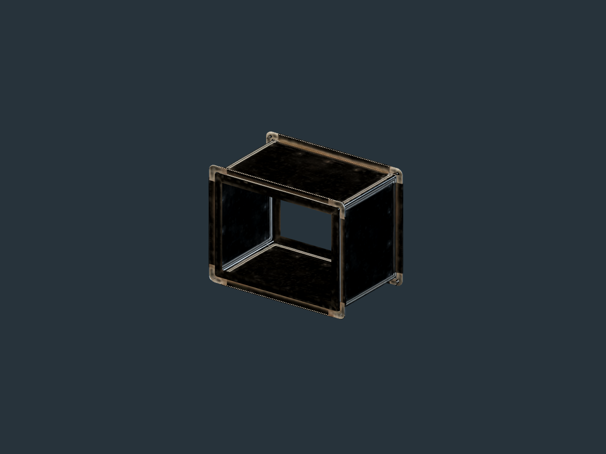
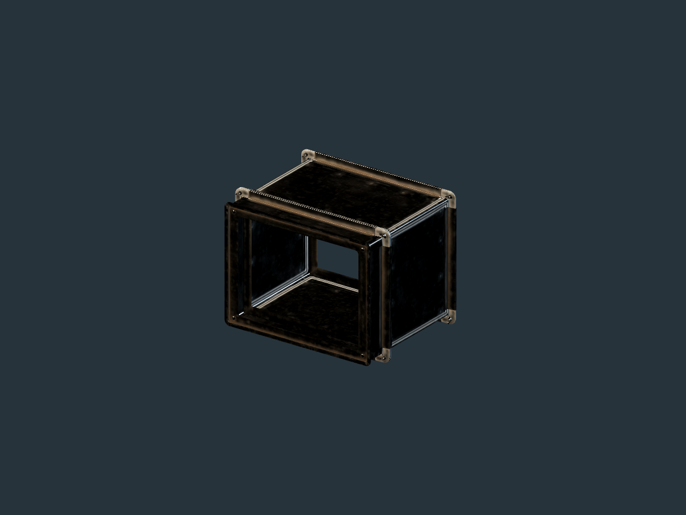

# Fitting player-placed collector components

This is an asset and clearance study for the new chapter-one collector. The
current [native recognizer](../../native/factory-assembly/src/assembly.cpp)
finds a wooden frame, tool mount, cutting edge, receiver tray and wooden or
softmetal shaft by their placed identities. The [Host
projection](../../native/factory-godot-world/src/host.cpp) now reports ready,
incomplete and ambiguous arrangements from real placed components. It does not
yet make those arrangements extract ore, transmit power or route output.

The layout is an opportunity for art that changes as the player builds. It is
also a direct test of whether native occupied space and visible geometry agree.
These observations were made on 2026-10-22 against main `5d5c440`, using passive
Godot 4.7.2 views in a private display. No desktop control or normal game
entry was used. None of the forms below has been adopted into the scene.

## The five anchors are not five complete mesh envelopes

The current adapter uses a 1.65 m cell and 0.4125 m quarter step. At level
zero, each placed component is anchored 0.825 m above the ground. Host
placement reserves only 0.14 m on each side of that point; the lower face of
the reserved cube is therefore 0.685 m above level zero. A frame that reaches
the floor, a receiver pan with a real rim, or a guarded 0.66 m transfer
housing cannot fit that volume. Native placement and actor collision must
change before any such art becomes a physical buildable.

Two arrangements from the recognizer were rendered. One points west, places
the receiver to one side and the shaft behind the frame. The other rotates
the ore direction, mirrors the receiver, puts the shaft on the opposite side
and raises the mount and edge one quarter step. In the first study, each
component was modeled within roughly 0.19 m of its horizontal anchor, apart
from proposed legs reaching the ground. I rejected the result: it looked like
five small objects on stilts rather than a cutter, and its seams made the
receiver and shaft appear disconnected. Replacing a placeholder sphere with
the actual prepared mineral-outcrop mesh did not solve the composition.

A second passive study reused the existing fitted collector casting and skid
around the same five anchors. The larger chassis read as one grounded machine,
but its opaque shell obscured the modular construction. The receiver and shaft
still floated visually outside the casting, and the borrowed complete-machine
form implied more structure than any one placed component currently owns.
Both studies remain rejected for scene use. Their scripts, original and
corrected render logs, source-rock views, and assessments are retained under
`modular-collector-art-20261022` in the local prototype evidence directory.

The next renderer should treat each component identity as a confirmed
attachment point. It needs authored frame, tool, edge, receiver and shaft
pieces with compatible sockets; generated members should bridge only the
confirmed joints. Incomplete arrangements show their installed parts without
a decorative working path. A ready result may select fitted connector variants
from the exact receiver and drive positions, while native World remains the
sole source of work, stock and power state.

## A sourced guard and flange candidate

[Poly Haven's Modular Airduct Rectangular 01](https://polyhaven.com/a/modular_airduct_rectangular_01)
is a CC0 model by James Ray Cock. The provider's
[metadata](https://api.polyhaven.com/info/modular_airduct_rectangular_01),
[file manifest](https://api.polyhaven.com/files/modular_airduct_rectangular_01)
and [license](https://polyhaven.com/license) were checked. The downloaded 1K
glTF descriptor, binary buffer and six image files matched the manifest's
declared byte lengths and MD5 values. The glTF has eighteen separate named
nodes, including straight, half-length, connector, bend, split and vent
pieces. Its catalogue translations spread them out for display; those offsets
are not connection geometry.

Godot imported the half-length and connector nodes as separate mesh instances
with their source material. Their local bounds were measured from the imported
meshes and agree with the glTF position accessor bounds:

| Piece | Local size in metres | Possible use and limit |
| --- | ---: | --- |
| Half-length duct | 0.663432 × 0.512613 × 0.400000 | A guarded transfer section near one quarter step long. It is a closed duct, not an open receiver pan or proof of material flow. |
| End connector | 0.663432 × 0.512613 × 0.096372 | A matching flange at an exposed end or a joint to another admitted section. It grants no native connection. |

I inspected the isolated half and joined views. The worn dark metal, raised
corners and visible flange make the small rigid pieces more convincing than a
plain generated box. The joined front and rear views show a continuous outer
profile at the sampled angles. This is a visual assessment of a source
candidate, not a measured all-angle seam, collision shape or worksite result.
Its cross-section exceeds the present 0.28 m component reservation by more
than twofold. The full provider scene and its two material groups are not a
shipping package; selecting and preparing a single component is still needed.

The first isolated source-view script produced images and returned exit zero,
but its log reported leaked render resources after reparenting imported nodes.
That run is retained
as a failed fixture lifecycle. A corrected script kept the imported scene
intact, hid unused nodes and freed its viewport before exit. It produced the
two images above with engine and private-display exit zero and no script or
resource errors; the software driver still warned that V-Sync cannot be
changed. This correction changes no asset mesh or game source.

The household [dustpan candidate](https://polyhaven.com/a/dustpan) was also
screened from its provider preview and metadata. Although its tray is about
0.4 m wide, the prominent long hand grip and domestic proportions would read
as a repurposed prop on this machine. It was rejected before import. No new
model, purchase or service is needed for this choice.

## Next buildable slice

Use one ground-level west-facing collector first. The native builder should
reserve the complete load-bearing frame and admitted connector volumes as
placed pieces accumulate, including terrain, foundations, other construction
and the physical actor. The visible feet must meet ground or an actual
foundation. The cutter must reach the confirmed ore face without burying its
solid body in the source collider. The receiver and shaft need explicit,
orientation-dependent structural joints; a connector cannot carry imaginary
material or power. These requirements may call for several native occupied
boxes rather than a single large box around each anchor.

Art should use selected, prepared source parts where their dimensions and
finish help, author the exposed cutting and receiving forms, and generate only
length-dependent rigid middle pieces. Test the ground arrangement as partial
and complete construction, with source-side and outlet-side ordinary-distance
views and native placement/collision checks. Then test the mirrored receiver
and side shaft, followed by the raised tool alternative. No screenshot or
source study here establishes the user's production-quality target or human
playability.
