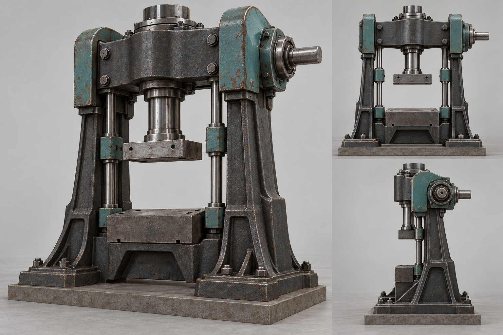

# Cast press frame assembly

The current press pairs the [qualified drill-press supports](../../experiments/engine-environment/godot/opening/assets/press-support/CREDITS.md) with an original fixed frame and the existing moving tool. The source supports remain at their measured mounts. The new dark cast uprights, deeper shoulders and rear tie make a continuous path from the crown to the feet while leaving the central ram, guides, anvil and side input visible. This is a presentation assembly; the native World still owns construction, power, motion, material and recovery.

The image is an AI-generated, original modeling reference made for this project on 2026-10-22. It is not a shipped mesh, a measured engineering drawing, a gameplay screenshot or evidence of a supported multi-press. Its shaft placement, surface wear and internal mechanism are suggestions only. The game uses the confirmed native press input and the existing tool pose, not an inferred mechanism from this image.

The earlier narrow crown taper was invisible at construction distance. A broader sloping crown looked like a roof, and an imported workshop CAD H-frame looked unfinished beside the prepared machine parts. Those rejected render pairs and source studies are retained under `press-crown-loadpath-20261022` and `press-portal-20261022` in the local prototype evidence directory. The present trial changes the full fixed frame's color and mass instead of adding another isolated trim edge.

The paired front and rear source-art views now show a heavier crosshead seated on darker side castings, while the original sourced columns remain behind them. The candidate still has simple large planes and less wear, edge detail and material variation than the concept. At the sampled construction camera the whole machine is small, so only the broader frame silhouette survives; this is a bounded improvement, not a claim that the press or complete scene meets the user's production-quality target. Matched renders, the first guide-collar contact failure and the final clearance results are retained under `press-cast-assembly-20261022` outside Git.

The machine pick body, native envelope, original source mesh and maps, mechanical input, finite kit, material stock, guide rods, tool head and travel do not change. A focused geometry check covers both view builders, all three projected axes, fixed-frame continuity, the central bore and unchanged tool travel. The first larger shoulder touched a guide-collar clearance at its lower edge; moving that edge upward left a measured gap. The separate horizontal input check covers its sixteen current axis, location, height and view combinations. These are source and isolated-engine checks. The trial does not establish human visual approval, interactive play, new press work, arbitrary player-sized frames or compound press-and-cut construction.
