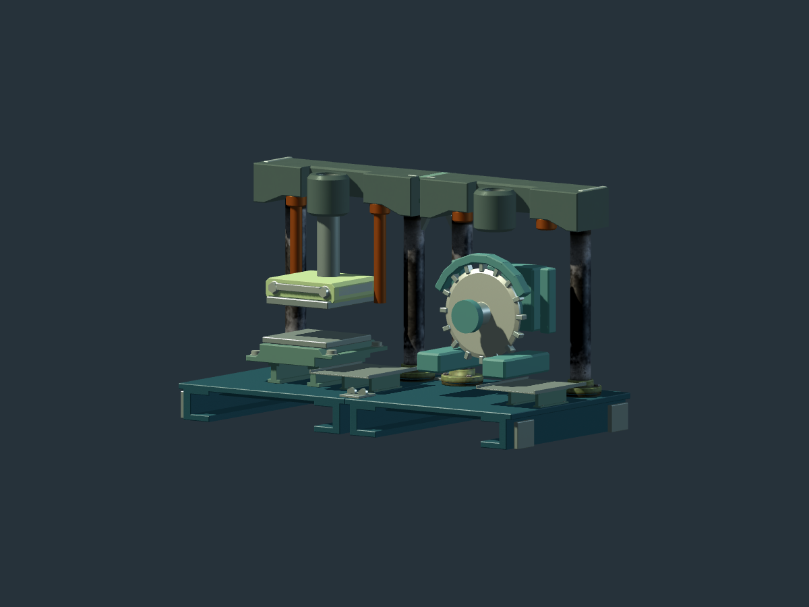
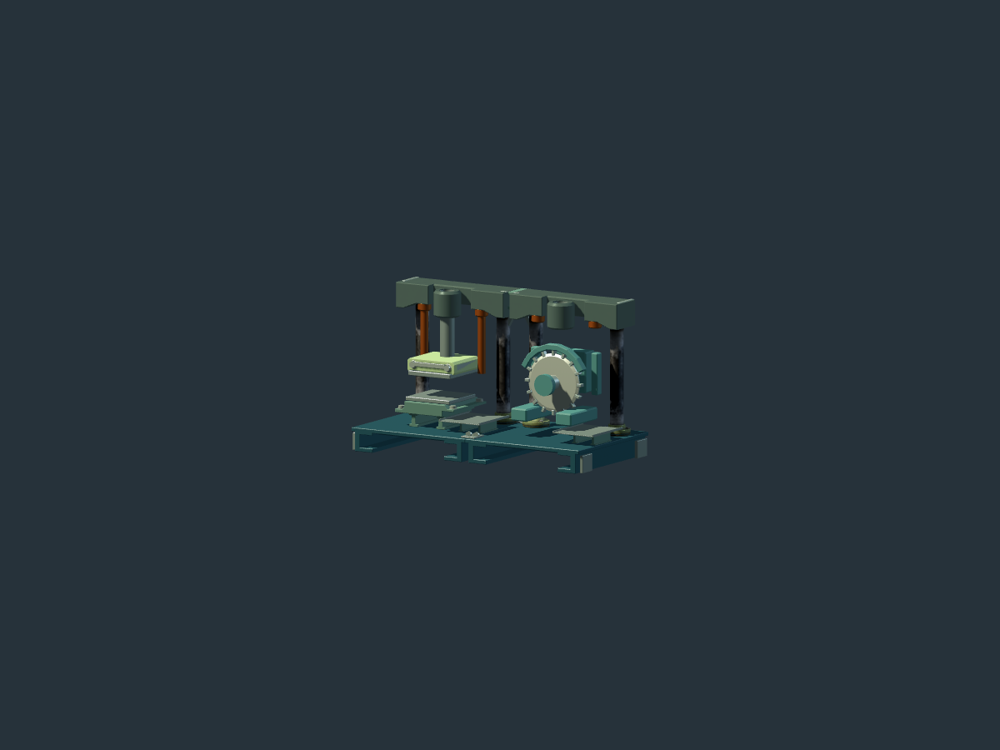

# Shared press and cutter frame: passive art sample

This sample tests whether a reusable frame can carry visibly different tool
modules without stretching the detailed parts. It uses the current sourced
press support, fitted frame joints, rigid skids and shared metal finishes. The
new cutter is original mesh geometry assembled in the retained passive study.
No compound machine, cutting
recipe, transfer path, power connection or collision has been added to the
native World or playable opening.

The script renders a two-press comparison, a press and cutter at 1.35 m bay
spacing, and the same pair at 2.10 m spacing. Each case has front, rear and
construction-distance views. Detailed bearings, fasteners, press die, source
columns and tool interfaces keep their sizes; only the existing plain frame
joint changes length. The press remains a vertical die above its anvil. The
cutter proposal uses an exposed 0.30 m rotary shear, sixteen separate insert
forms, an upper guard, a supported spindle and two bolster cheeks around the
work opening. Its supposed drive case is visual context, not an admitted motor.

In the passive views, the rotary tool has a distinct silhouette even at the
sampled construction distance; the first, wedge-shaped cutter trial still read
as another press at that distance and was rejected. The shared skid and crown
join look deliberate from the front. The wide rear view exposes how the drive
case and frame brace meet, but the cutter still has no confirmed item or power
route. The exposed teeth and simple guard are a form study, not finished
production art or evidence of safe cutter clearance.

The original render source and all nine views for each iteration are retained
under `press-cut-component-sample-20261022` in the local prototype evidence
directory. The final sample was rendered from main source revision
`2212b85f34745e214ac2df236a6d0a0d2a53b846` in a linked worktree with the
pinned Godot 4.7.2 Compatibility renderer. The isolated engine and private
display server completed normally. No desktop input, game entry, native
construction or human quality judgment occurred. The two images above are
selected passive frames, not playable screenshots.

The next functional step belongs to native construction: a confirmed compound
assembly needs separate press and cutter identities, a structural join, tool
mounts, material and shaft endpoints, and collision and custody rules. Only
then can the opening bind these proposed components to real placement,
removal, stalled motion and saved state. The pending functional press assembly
task is `factory-yau.1.10.8`; it does not already implement this mixed tool.
