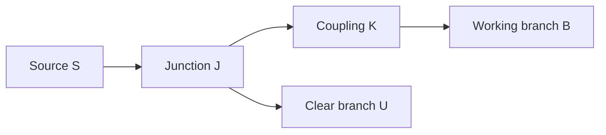

# Mechanical risk fixtures

Status: proposed bounded test fixtures, not implemented mechanics or a production
stack decision. Written after the basic opening at `be698ab`. This does not add
requirements to that available demo or delay user feedback. The opening's
wheel-reachability flag, rotating mesh and orbit camera do not establish gearing,
moving-body collision, playable passengers or transfers in motion.

This brief refines W-direction, W-geometry, W-obstruction, W-carrier, W-player,
W-harvest and W-transfer in the [common witness](prototype-witness.md). It carries
forward [construction and movement](../../DESIGN.md#construction-and-movement),
[complexity and automation](../../DESIGN.md#complexity-and-automation) and
[predictable motion](../../DESIGN.md#predictable-motion-and-physical-appearance).
The [stationary authority contract](stationary-authority-contract.md) supplies
command/request distinctions; its completed stationary tests are not moving-world
evidence. [Save/resume ownership](save-resume-contract.md) applies when those
moving facts are later checkpointed. No new API or second rules owner is defined.

## Common setup and observation boundary

Use one small site and one authoritative mechanism instance, consumed headlessly
and by its actual 3D scene. If contact is engine-owned, the headless contact test
must run that engine's real collision/authority consumer too; a standalone math
model cannot certify the physical join. Identify who owns topology, drive phase,
assembly motion, contact decisions, player movement and each item location.
Rendering reads those results; it cannot grant power, move stock or repair them.

The following are reversible developer-fixture assumptions, not chapter content:

- Use a labelled global basis with y up and construction spacing `u`. Record the
  candidate's actual axes and units; `u` selects no final block dimensions.
- Start from an explicitly declared stationary construction state. Keep a part's
  assembly-local mount separate from the assembly's operating world transform:
  `world_part(t) = world_assembly(t) × local_mount`. Include an intermediate pose
  away from construction alignment. Do not round every operating pose to a cell.
- Use fixed endpoints/phase and declared gearing, with finite labelled test stock
  and explicit reset between independent cases. No invisible refill during a run.
  Fixed-cycle repetition needs no player-authored sequencer or late control unlock.
- Record input admission, actual advancement and contact/transfer commit boundaries
  separately from rendered frames. Observe the same declared boundaries on both
  consumers; log before/after state and the first divergence. A later green frame
  cannot erase an earlier penetration, lost item or extra processing step.
- Declare test-only geometry, eligible contacts, transfer reach, cycle endpoints,
  speed and observation tolerances before running. These bound a reproducible
  fixture; they are not game units, torque laws, network/performance targets or
  final docking rules. Use no unbounded sweep or benchmark as a correctness test.

## Cases that distinguish competing implementations

### M1 — Construction frame and operating frame

Place/connect a stationary assembly through the actual command path; record its
members, local mounts, carried-part costs and world placement. Drive it to a
non-grid operating pose, including a rotation. Inspect the actual rendered
geometry **and collision shapes** against the authoritative assembly transform.
The members retain their local relationship; contact queries use their current
world poses. Submit a construction edit in motion: it must not apply or charge
parts. This does not imply every stopped pose permits editing.

Control/failure: a static copy at the construction pose must give different
contact locations. A moving visual with stationary colliders, grid-snapped
operation, detached membership or a client-only rejected edit is a failure.
Do not teleport back to the grid to conceal an unsupported operating pose.

### M2 — Useful direction and gearing

Declare shaft axes and the positive observation direction. A simple fixture may
use external 20:40 meshing gears: one mesh gives signed output phase `-input/2`;
an added idler gives `+input/2`. These tooth counts are test values, not selected
parts. Measure unwrapped phase so wrapping cannot conceal a reversal or ratio
error. Reconfigure only at the fixture's declared stationary edit state.

Attach a real driven feed/tool consumer. In the positive route its signed drive
must carry finite test stock toward the marked working encounter; the reversed
route must actually change feed/contact behavior. Keep stock accounted for when
the route is wrong. Record the consumer's drive input and item/contact outcome,
not merely three rotating mesh angles. No reverse-feed destruction rule is chosen.

Control/failure: change only the mesh parity or declared ratio, keeping input
advancement and load geometry fixed. Correct-looking gears with an unchanged
always-forward feed, wrong axis convention or frame-rate-dependent phase fail.
This probes kinematics, not load distribution or a complete torque simulation.

### M3 — Rotary and gantry fixed cycles

Use two labelled work opportunities that both layouts can physically reach.
Declare a rotary axis, radius/tool mounts and one complete revolution; declare a
gantry axis, stroke endpoints and out/return cycle. Run the real attached tool
through material at those opportunities. Trace its swept clearance, drive phase,
actual work decisions and retained stock through a complete cycle and reversal.
Record return-stroke eligibility explicitly; reversing cannot harvest an already
removed source again or manufacture another output.

Extend the **same** opportunities by one perpendicular row. Adapt each layout
within its declared construction rules and record added parts, swept bounds,
feed access and stroke/radius changes. For a fixed baseline, a second gantry tool
can extend a crossbeam without lengthening its stroke; test whether the chosen
rotary mounts require a larger radius. Do not declare that every rotary layout
must grow, that either layout wins, or that gantries unlock later.

Control/failure: the empty cycle must move but produce nothing. A tool/head
animation with fixture-injected results, missed working clearances, double work
at reversal, phase reset or a comparison using different work opportunities fails.
An attractive vertical stack alone supplies no additional functional-height proof.

### M4 — Intended contact, obstruction and isolation

Use one source S, a common junction J, an isolating coupling K and two real driven
branches: obstructable B and otherwise clear U.

First demonstrate declared tool/material contact that performs accounted work.
Replace that encounter with a labelled inert solid obstruction, keeping the
relevant geometry and advancement fixed. Exercise an internal clearance of the
gantry-plus-contraption and a fixed external obstacle as separate cases; the
gantry and attached contraption are one machine, not independent machine pushing.

With K engaged, actual obstructed contact stalls the mechanically connected
drivetrain, including U, without machinery damage. Record phase/contact and stock
at that boundary; do not pass through the obstacle and report a stall afterward.
Disengage K through the candidate's actual control: B remains obstructed while U
can advance and do work. Remove the obstacle, then re-engage under a declared
test restart condition. Resume retained work without resetting phase, topology,
held material or machine identity. That condition is not a universal restart rule.

Control/failure: a clear repeat proceeds; eligible tool contact is not treated as
an unintended obstruction. Only stopping the blocked mesh, silently isolating B
while K is engaged, freezing U after isolation, disabling all self-collision, or
deleting held work to recover fails. An activation veto/clearance preview alone
does not demonstrate actual contact and connected stall behavior. Damage severity,
injury and detailed collision feedback remain open.

### M5 — Constrained train-like assembly with working machinery

Use one carrier/deck and attached tool along a bounded constrained route with a
bend and a declared stop/reversal. The bend distinguishes assembly orientation
from translation alone. This selects no track catalogue, routing, coupler physics
or independent pushing behavior. Record path identity, progress, direction,
world pose and member mounts at intermediate off-grid positions.

Run the attached machinery while the carrier moves. Mark one eligible finite
material encounter and a same-route no-material control. A real tool contact
must debit that source and credit a declared material owner exactly once; no
encounter means no harvest. Movement cannot disconnect the drive or reset process
phase invisibly. A moving deck with idle props or scripted output is insufficient.

Control/failure: returning past a depleted source cannot harvest it again. A
wrong-facing/absent contact cannot gain stock. A path reset that hides an invalid
working pose, detached tool, duplicated source debit or vanished held item fails.

### M6 — Actual playable passenger and authority join

Use the candidate's real playable controller, collision body, input handler and
authoritative movement/correction path. The current opening has an orbit camera,
so it supplies no playable passenger consumer; that join must actually be built
in a later scoped trial before this case can pass.

Board from stationary ground, move with the carrier, walk relative to its deck,
encounter a fixed solid boundary, and leave through ordinary movement input.
Include the route's bend/reversal. Observe world and assembly-relative player
pose, support/contact state and the authority's decision alongside the carrier
pose. Declare a bounded provisional contact result, without selecting health,
injury severity, respawn, docking or independent pushing policy.

Then use two real clients P/Q and one authority: P supplies passenger input, Q
observes. Hold/release an input or correction across a known carrier advancement
boundary using an explicit barrier, recording actual accepted order. Verify the
real player body and observers converge to the authority's coherent contact and
pose under the declared correction policy. Record prediction/interpolation if
used; universal rollback is not assumed. Expand request/rejoin cases with `.5.5`,
rather than inventing a second movement authority here.

Control/failure: a camera or parented dummy travelling correctly cannot pass.
Neither can a player frozen relative to the deck despite walk input, a visual
correction that leaves its collider behind, duplicated body, stale correction
through a solid, or scripted boarding/leaving that bypasses the controller.
Record unsupported contact cases instead of silently substituting a mock.

### M7 — Moving/fixed transfer at a real eligible encounter

Give the carrier and one stationary station distinct inventories; start with one
labelled item and one free destination slot. Declare a temporary transfer reach
and facing condition for the trial. While the carrier is actually moving, use
the real interaction/authority path to transfer at an eligible encounter. Reverse
the roles for moving-to-fixed and fixed-to-moving checks. Neither demonstration
can silently stop, snap or dock the carrier to make the moving case pass.

Record target identities, actual relative pose at authoritative admission,
source removal, destination credit and any intermediate owner. Sum all owners
per material identity; a staged transfer must keep an explicit owner until its
declared commit/return. Repeat outside reach, with a full destination and after a
stale visual observation of the encounter. Refusal cannot change stock ownership
or reset mechanism phase; subsequent ordinary movement remains allowed.
Let P/Q contend for the same single item under an explicit release schedule,
then repeat with sufficient stock: it cannot be credited twice or retarget a
replacement station. Retain true retry outcomes; do not retry blindly to pass.

Control/failure: overlapping visual meshes alone cannot authorize delivery;
scene callbacks cannot each credit an end. Always-eligible transfer, stationary
substitution, duplicated/lost in-flight stock or a stale target that changes a
replacement inventory fails. The eligibility condition proves one experiment,
not accepted docking tolerances, permanent port behavior or a shipping system.

## Smallest next trial and handoff

For the next implementation task, start with M1/M2/M4 and one fixed-cycle motion from
M3: it discriminates shared drive/pose/contact ownership before a larger carrier
scene. The other M3 layout, train-like M5, actual M6 passenger and M7 transfer
remain named follow-on proofs, not optional omissions from eventual moving-world
validation. This is a suggested test order, not a chapter unlock sequence or
runtime authorization. Keep the basic opening available throughout.

Before execution, record the exact candidate, real consumer entry points,
provisional parameters, ownership seams, release schedule and resource envelope.
Each case needs initial/final authoritative facts, submitted/accepted intents,
contact/phase/pose observations, material ledger, actual client results where
required, and a narrow pass/fail/not-run/unsupported disposition. Keep positive
and changed-one-condition controls with the first failure. Visual evidence joins
those facts; it cannot substitute for them. **All M1–M7 are unrun in this brief.**

Motion-phase/contact/passenger/transfer facts needed to continue must enter the
later moving-save/rejoin contract (`.5.5`/`.5.6`), then the combined witness. A
static snapshot or stationary save result cannot establish moving continuation.
No serialization format or physical-state owner is selected by that obligation.

Still deferred: stopped versus docked edit eligibility; reattachment/alignment
and port tolerances; independent machine pushing; dropped-item and assembly-to-
assembly contact; terrain effects; player injury/contact consequences; restart
and coupling details beyond each declared fixture; final camera/controller,
multiplayer quality/scale targets and production engine adoption. No clearance
preview, activation restriction or destructive collision policy is adopted here.
